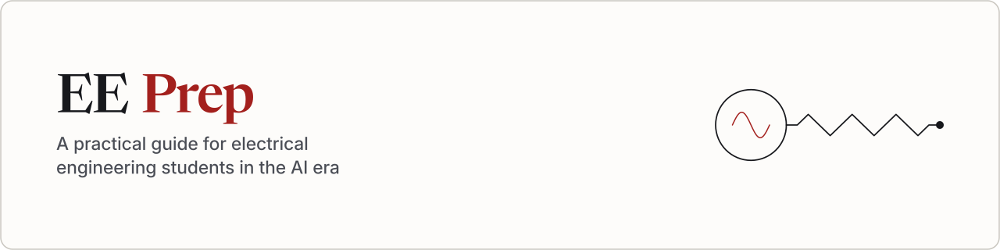

A practical guide for electrical engineering students in the AI era: how to study, how to land your first internship, and the resources worth your time.

## What it is

EE Prep is a guide for electrical engineering students. It covers how to study, how to get a first internship, and which references are worth keeping. The pages are a static site built with Astro and Starlight.

## Who it is for

The guide is for electrical engineering students. It follows the courses and the job search those students actually have.

## What's inside

Three sections are in the site now.

- Get hired, with Resume and The job market. Both pages are still placeholders.
- Succeed in school, with How to study
- Reference, with Signals and DSP and a sample page. Signals and DSP is still a placeholder.

The sample page is there to show a wikilink, a callout, an equation, and a figure. It is not a study guide.

## How sources are handled

Every claim in the guide cites a source. The page gives that source credit, so a reader can check the claim. A claim with no source stays out of the guide.

## Status

The public site will be at [eeprep.com](https://eeprep.com). It is coming soon, and it is not live yet.

Contributing: see .github/CONTRIBUTING.md

Security: see .github/SECURITY.md
